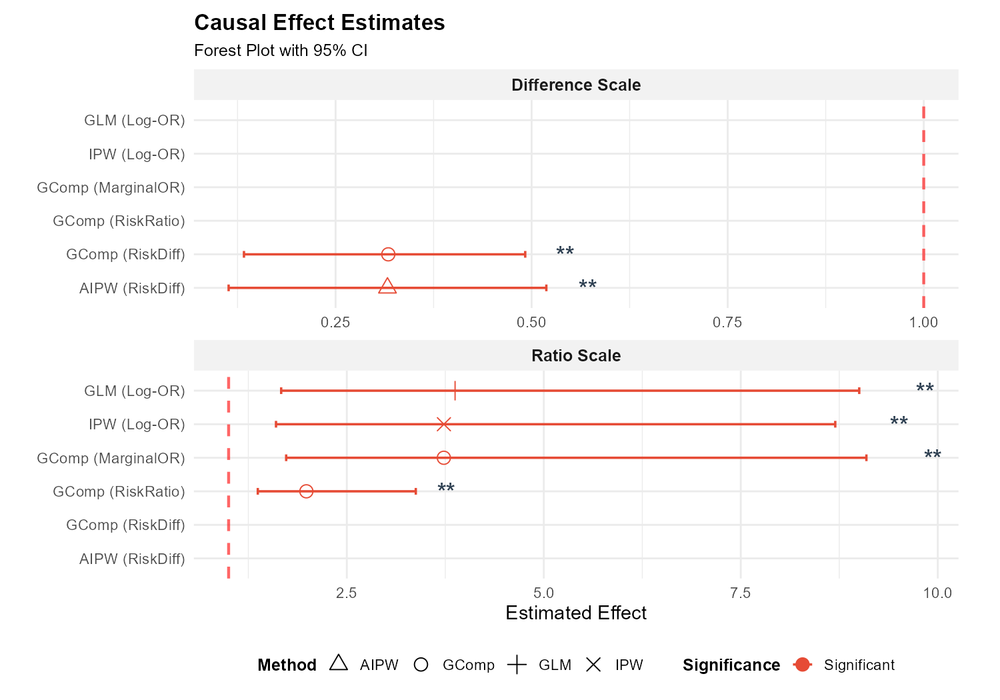
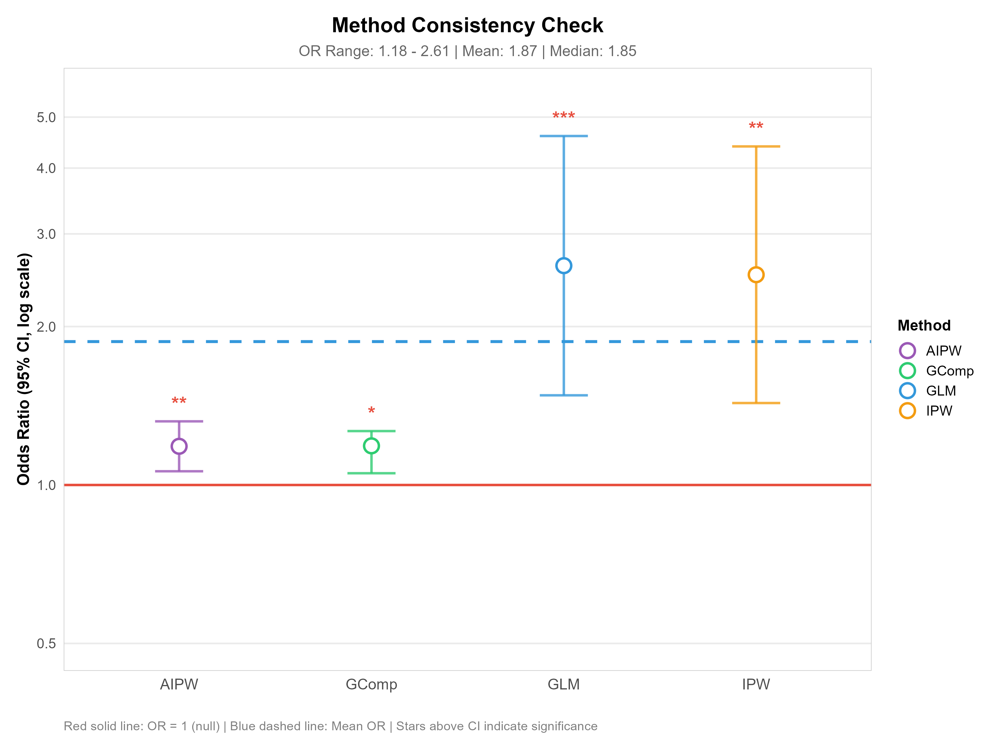
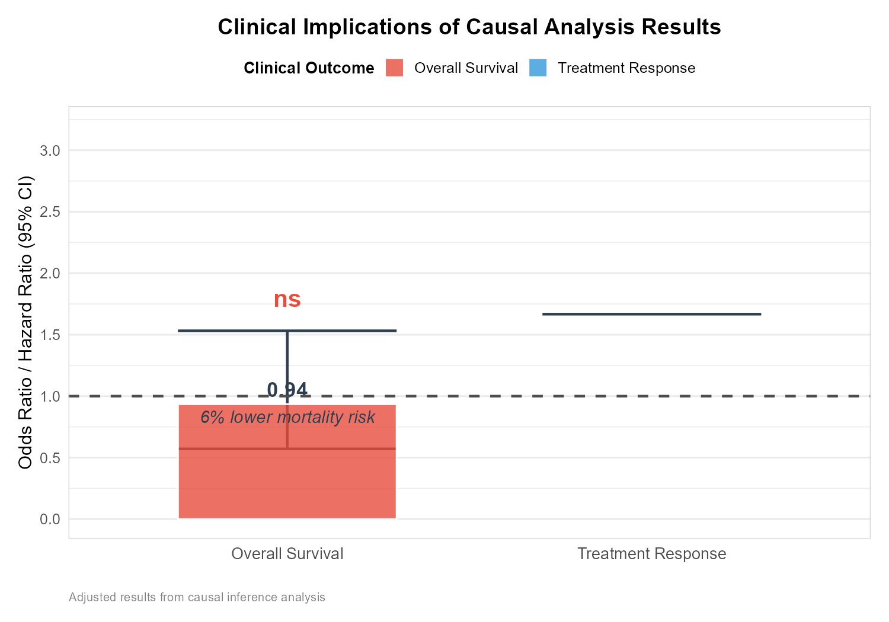
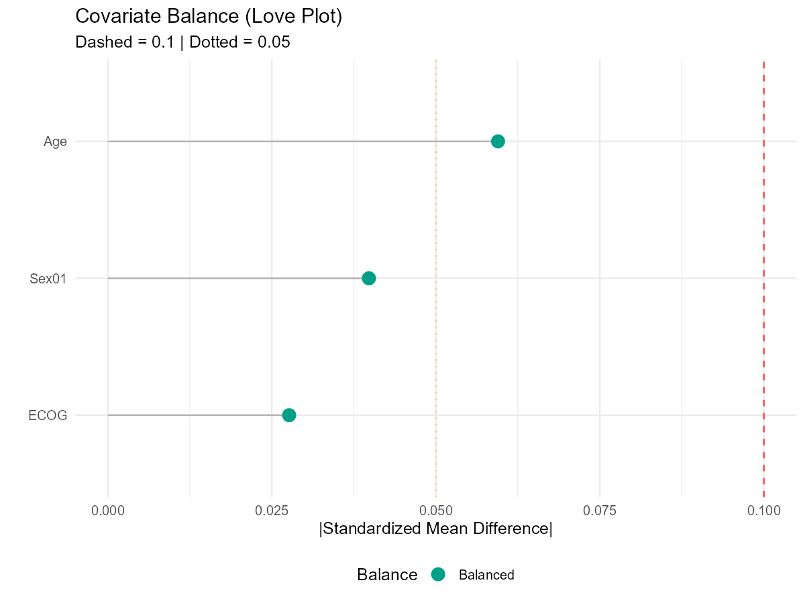

<!-- Generated from figures.qmd. Edit the QMD source and rebuild. -->

# Figures and export

[Book contents](../README.md) · [Previous: Multi-Method Comparison](methods/comparison.md) · [Next: Use the IOBRcausal Skill](agent-guide.md)

Start from [saved results](workflows/saved-results.md) when your numbers already
exist. The original figures below are retained unchanged from earlier examples;
they are not outputs of the Book's small synthetic installation check.

## Forest plot

Read the estimate, its interval and its own reference scale. Compare compatible
contrasts; a risk difference and an OR cannot share one numerical interpretation.



## Method consistency

Look for agreement and disagreement across methods. Shared assumptions or bias
can produce agreement, so this plot does not independently establish causality.



## Clinical summary

Response and OS describe different endpoints. Keep odds ratios, hazard ratios
and absolute survival contrasts distinct.



## Covariate balance

Inspect standardized differences before and after adjustment. Balance on measured
covariates does not prove exchangeability or absence of hidden confounding.



## Advanced R plotting

These direct R functions are useful for an existing workflow object `res`:

```r
iobr_causal_plot(res, type = "forest")
iobr_causal_visual_report(res, output_dir = "figures",
                         formats = c("png", "pdf", "svg"))
```

For a pathway-first object, use `iobr_causal_pathway_first_visual_report()` for
the route-specific overview. Read the help for functions that may compute curves;
the shared saved-number `plot` operation has a separate no-fit contract.

Use PNG for a quick preview, PDF for layout and SVG for editable vector output.
Keep the source tables, full rows and provenance with the figures. Historical
numeric context is in the [original examples appendix](reference/historical-examples.md).

---

[Book contents](../README.md) · [Previous: Multi-Method Comparison](methods/comparison.md) · [Next: Use the IOBRcausal Skill](agent-guide.md)
