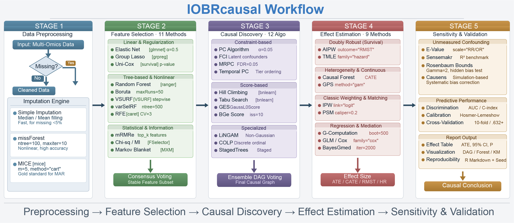

<!-- Generated from index.qmd. Edit the QMD source and rebuild. -->

# IOBRcausal

[Book contents](../README.md) · [Next: Installation](installation.md)

Explore expression and clinical data, follow pathways to candidate genes, and
turn the results into tables and figures you can read and share.

[**First time here?** Install the package and try a small example.](installation.md)

[**Use your own data** Choose a workflow and prepare the inputs.](data-preparation.md)

[**Already have results?** Read or plot the saved evidence.](workflows/saved-results.md)

Start with expression and clinical data for **pathway-first discovery**.
If your question already names a gene, signature or score, use the
**exposure-first workflow**. You can work in R or use the IOBRcausal Skill.

New users can follow [installation](installation.md),
[the first analysis](quick-start.md), and [reading results](results/reading-results.md).
For a specific estimator, go straight to the [method guide](methods/index.md).

This Book documents version **32.2.3**. Examples use synthetic data; the original
figures remain available with their historical context. See
[validation and support](reference/validation.md) before reporting an analysis.

---

[Book contents](../README.md) · [Next: Installation](installation.md)

## All chapters

- [IOBRcausal](index.md)

## Getting started

- [Installation](installation.md)
- [Your first analysis](quick-start.md)
- [Prepare your data](data-preparation.md)

## Workflows

- [From expression to pathways and genes](workflows/pathway-first.md)
- [Analyse a specified gene or score](workflows/exposure-first.md)
- [Read or plot saved results](workflows/saved-results.md)

## Reading results

- [Read the results](results/reading-results.md)
- [Diagnostics and sensitivity](results/diagnostics.md)

## Methods

- [Choose a method](methods/index.md)
- [GLM (Generalized Linear Model)](methods/glm.md)
- [G-Computation](methods/gcomp.md)
- [AIPW (Augmented Inverse Probability Weighting)](methods/aipw.md)
- [IPW (Inverse Probability Weighting)](methods/ipw.md)
- [TMLE (Targeted Maximum Likelihood Estimation)](methods/tmle.md)
- [PSM (Propensity Score Matching)](methods/psm.md)
- [Causal Forest](methods/causal-forest.md)
- [GPS (Generalized Propensity Score - Continuous Exposure)](methods/gps.md)
- [Multi-Method Comparison](methods/comparison.md)

## Figures and Skill

- [Figures and export](figures.md)
- [Use the IOBRcausal Skill](agent-guide.md)

## Reference

- [Parameters and analysis settings](reference/parameters.md)
- [Function reference](reference/functions.md)
- [Troubleshooting](reference/troubleshooting.md)
- [Validation and method support](reference/validation.md)
- [Advanced analysis](reference/advanced.md)
- [Citation and support](reference/citation.md)

## Appendix

- [Original examples and figures](reference/historical-examples.md)
