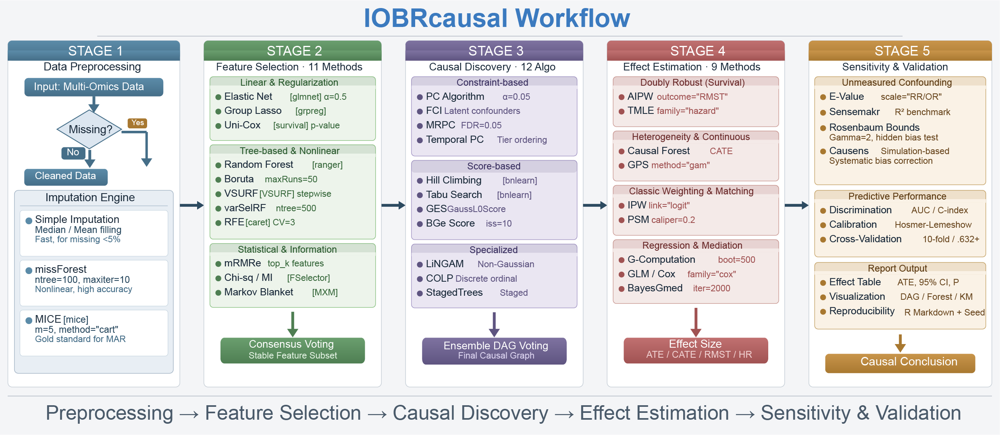

::: {.book-intro}
Explore expression and clinical data, follow pathways to candidate genes, and
turn the results into tables and figures you can read and share.
:::

::: {.start-links}
[**First time here?** Install the package and try a small example.](installation.qmd)

[**Use your own data** Choose a workflow and prepare the inputs.](data-preparation.qmd)

[**Already have results?** Read or plot the saved evidence.](workflows/saved-results.qmd)
:::

Start with expression and clinical data for **pathway-first discovery**.
If your question already names a gene, signature or score, use the
**exposure-first workflow**. You can work in R or use the IOBRcausal Skill.

New users can follow [installation](installation.qmd),
[the first analysis](quick-start.qmd), and [reading results](results/reading-results.qmd).
For a specific estimator, go straight to the [method guide](methods/index.qmd).

This Book documents version **32.2.3**. Examples use synthetic data; the original
figures remain available with their historical context. See
[validation and support](reference/validation.qmd) before reporting an analysis.
